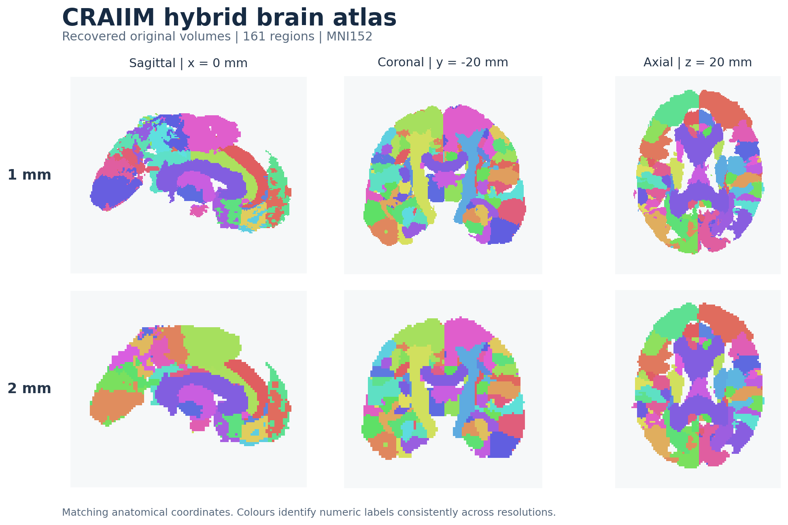

# CRAIIM — Hybrid Brain Atlas

**161-region MNI152 brain atlas | 1 mm & 2 mm | NIfTI | FSL-based hybrid parcellation**

Research archive of the *CRAIIM Hybrid Brain Atlas* developed by **Alberto A. Vergani**, in collaboration with **Renzo Minotto, Sabina Strocchi and Elisabetta Binaghi**, during doctoral research at the **University of Insubria**. CRAIIM is *Centro di Ricerca in Analisi di Immagini e Informatica Medica*.



**Public release status:** Scientific documentation, anatomical label lookup, validation metadata and Python utilities are available here. The original atlas NIfTI volumes and historical documents are preserved in the author's research archive but are **not redistributed in this public repository** pending a review of third-party licensing.

## What is CRAIIM?

CRAIIM integrates **121 regions from the Jülich Histological Atlas** with **40 selected Harvard–Oxford cortical/subcortical regions** to cover anatomical territories missing from the Jülich parcellation. The merged maps contain **labels 1–161**, with `0` reserved for background, in **MNI152** space. All nonzero label IDs are present in each supplied volume. Both volumes are categorical, maximum-probability-style `thr0` label images, not continuous probability atlases.

The work was designed to facilitate region-based interpretation of functional MRI activity and *Activation Weighted Vector* (AWV) workflows. The atlas is an anatomical lookup/partition; **it is not a pre-computed AWV or an fMRI activation dataset**.

The two recovered NIfTI files are alternative spatial **resolutions of one atlas**, not separate dated releases.

## Atlas files and downloads

| Atlas | Voxel size | Shape | Labelled voxels | File |
| --- | --- | --- | ---: | --- |
| Original CRAIIM 1 mm | 1 × 1 × 1 mm | 182 × 218 × 182 | 1,604,767 | Not publicly available pending licensing review |
| Original CRAIIM 2 mm | 2 × 2 × 2 mm | 91 × 109 × 91 | 213,214 | Not publicly available pending licensing review |

- [Anatomical lookup: 161 ROI names + provenance + voxel counts](metadata/atlas_labels.tsv)
- [Raw region voxel counts at both resolutions](metadata/region_voxel_counts.tsv)
- [Image geometry and SHA-256 metadata](metadata/atlas_manifest.json)
- [SHA-256 checksums](checksums.sha256)

**Redistribution notice:** The author's private archive retains the original volumes. Public release of FSL-derived NIfTI files requires verification of the applicable third-party rights and permissions. See [DOWNLOADS.md](docs/DOWNLOADS.md) and [LICENSE_AND_REUSE.md](docs/LICENSE_AND_REUSE.md). No license is asserted for the underlying atlas data.

## How was the atlas constructed?

The original integration proceeded in this order:

1. Use the Jülich Histological Atlas as the anatomical base (121 regions).
2. Select 40 complementary Harvard–Oxford regions, covering cortical and subcortical territories not represented by Jülich.
3. Preserve Jülich voxel labels wherever occupied; add selected Harvard–Oxford labels **only where Jülich is background** (overlap is resolved in favour of Jülich).
4. Re-index added territories as CRAIIM labels **122–161**, maintaining the original Jülich labels **1–121**.
5. Preserve the two historical maximum-probability `thr0` atlas grids in MNI152, one at **1 mm**, the other at **2 mm**.

This is a description of the documented historical construction rule, **not a claim that the original atlas-building source code has been recovered**. See [ATLAS_CONSTRUCTION.md](docs/ATLAS_CONSTRUCTION.md), and the 2018 PhD thesis (§4.1 and Appendix 6.1).

## Quick start

You can validate the anatomical lookup without NIfTI volumes:

```bash
python scripts/test_label_table.py
```

**For atlas validation**, first obtain the two archived original NIfTI files (subject to permissions) and place them under `atlases/original/`. The next commands require those files:

```bash
python -m pip install -r requirements.txt
python scripts/inspect_atlases.py
sha256sum --check checksums.sha256
```

Example: count voxels in one atlas label with `nibabel`:

```python
import nibabel as nib
import numpy as np
atlas=nib.load("atlases/original/CRAIIM-maxprob-thr0-2mm.nii.gz")
labels=np.asarray(atlas.dataobj).astype(np.int16)
print("Number of voxels in ROI 122:",np.count_nonzero(labels==122))
```

For anatomical names use `metadata/atlas_labels.tsv`, transcribed from thesis Appendix 6.1. Example region-level fMRI aggregation requires transforming the input data to the same space and grid as the atlas; do **not** assume arbitrary fMRI NIfTI are aligned. Refer to [USAGE.md](docs/USAGE.md).

## Documentation

| File | Content |
| --- | --- |
| [Atlas construction](docs/ATLAS_CONSTRUCTION.md) | Sources, merge rule, region definitions, limitations |
| [Using CRAIIM](docs/USAGE.md) | Python and FSL examples with alignment caveats |
| [Downloads and file inventory](docs/DOWNLOADS.md) | Original files, format and source links |
| [Integrity and validation](docs/VALIDATION.md) | Geometry, checksums, voxel counts |
| [Provenance and recovery](docs/PROVENANCE.md) | Thesis transcription and recovered assets |
| [Licensing and reuse](docs/LICENSE_AND_REUSE.md) | Upstream licensing review before redistribution |
| [Recovery notes](docs/RECOVERY_NOTES.md) | Missing original build scripts, preservation record |
| [Bibliography](references.bib) | Three copy-ready BibTeX references |

## Cite CRAIIM

For research using CRAIIM, the following three references document the foundational work: the **2016 FSL/AWV conference abstract**, the **2017 HBP presentation (2018 proceedings)**, and **Vergani's 2018 PhD thesis**. Copy complete BibTeX from [references.bib](references.bib), or use [CITATION.cff](CITATION.cff) as repository citation metadata.

1. Vergani AA, Minotto R, Strocchi S, Binaghi E (2016). *FSL-Based Hybrid Atlas Promotes Activation Weighted Vector Analysis in Functional Neuroradiology*. [DOI:10.3389/conf.fninf.2016.20.00077](https://doi.org/10.3389/conf.fninf.2016.20.00077).
2. Vergani AA, Minotto R, Strocchi S, Binaghi E (2018). *Quantitative Relations between CRAIIM Human Brain Atlases*. *1st HBP Student Conference* proceedings, Vienna (conference held 2017), ISBN 978-2-88945-421-1. [Proceedings PDF](https://sos-ch-dk-2.exo.io/public-website-production-2022/filer_public/a3/76/a3766610-0aa4-46cf-822a-163fa9cfa779/9782889454211.pdf).
3. Vergani AA (2018). *Contributions in Computational Intelligence with Results in Functional Neuroimaging*. PhD thesis, University of Insubria. [Institutional PDF](https://irinsubria.uninsubria.it/retrieve/e2188be7-5825-4564-e053-6605fe0a49d6/PhD_Thesis_VerganiAlbertoArturo_completa.pdf).

## Limitations and historical fidelity

- The original atlas-construction scripts have not been found. The **original atlas volumes are preserved byte-for-byte in the author's research archive**, while ancillary tables and metadata are reconstructed.
- `metadata/atlas_labels.tsv` is a **transcription from the PhD thesis**, not a historically recovered FSL label file; original spelling and label identification are retained (including possible typographical errors).
- The archived original labels are stored as `float32` numeric voxels but contain integer values 0–161.
- NIfTI voxel grid and alignment matter. Use nearest-neighbour interpolation for categorical masks if you must resample.
- This work is historical research software/data. No clinical validation is claimed.
- **No blanket license** is asserted for the FSL-derived volume files, thesis, or archival conference artifacts.
